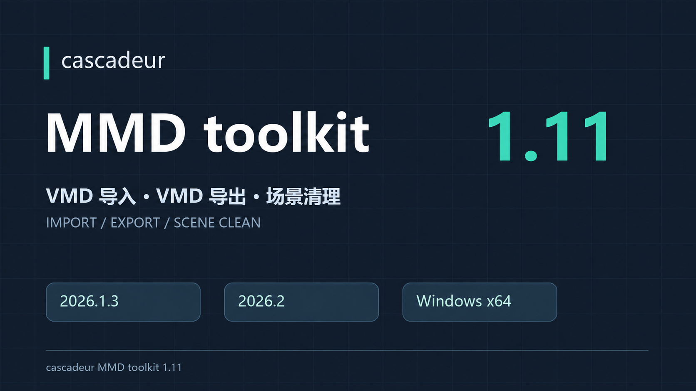
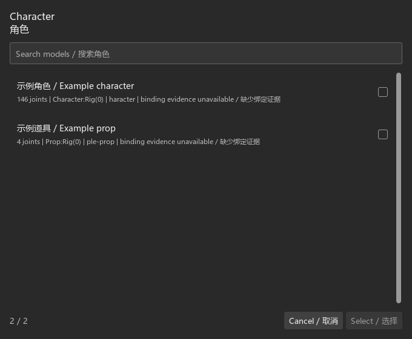
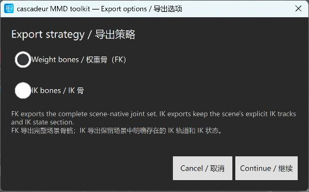
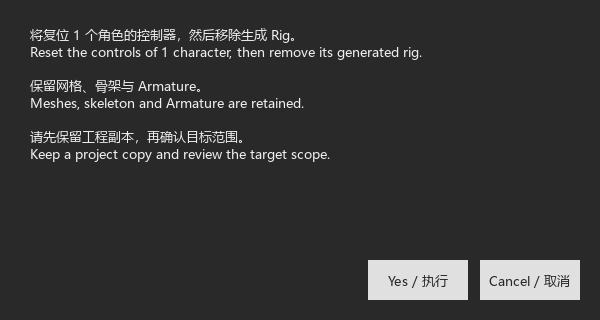

# cascadeur MMD toolkit 1.11

面向 Cascadeur 的 MMD 骨骼动画工具集，支持 VMD 导入、VMD 导出和生成 Rig 清理。

An MMD skeletal animation toolkit for Cascadeur, with VMD import, VMD export and generated-rig cleanup.

**兼容 Cascadeur 2026.1.3 与 2026.2（Windows x64）。** 安装器按宿主实际脚本接口选择路线。旧版所需的最小 Python/Qt 绑定已包含在安装包内，无需另装 Python、Blender、MMD 或桥接插件。

**For Cascadeur 2026.1.3 and 2026.2 on Windows x64.** The installer selects the route using the host scripting interfaces. Required minimal legacy bindings are bundled; no separate Python, Blender, MMD or bridge plugin is needed.

**[下载完整安装包 Download ZIP](https://github.com/BrianFinch-1/cascadeur-mmd-toolkit/releases/download/v1.11/cascadeur-MMD-toolkit-1.11.zip)** · **[中英使用教程 PDF User Guide](https://github.com/BrianFinch-1/cascadeur-mmd-toolkit/releases/download/v1.11/User-Guide.zh-en.pdf)** · [全部发布 Releases](https://github.com/BrianFinch-1/cascadeur-mmd-toolkit/releases)

请下载上方安装包；GitHub 自动生成的 Source code 压缩包只包含此发布仓库的说明和文档，不是插件安装包。

Use the installation ZIP above. GitHub's automatic Source code archives contain only this distribution repository's documentation, not the plugin installer.

## 功能 Features

- **Import VMD**：选择已识别的 MMD 人物或受支持道具，将 VMD 骨骼动作写入时间轴。一次选择多个模型时，它们共用同一份 VMD。Import skeletal motion into detected characters or supported props. Multiple models selected together share the same VMD.
- **Export VMD**：从场景实际骨骼运动导出，人物可根据骨架条件选择 FK 或 IK；多模型分别输出。Export evaluated skeletal animation, with FK/IK choices where supported and separate files for multiple models.
- **Scene Clean**：在当前帧复位检测模型的控制器，再移除生成 Rig，保留网格、骨架和 Armature。Reset controls at the current frame and remove generated rigs while retaining meshes, skeletons and armatures.

## 1.11 更新 Changes

保留导入时间轴原有 IK/FK 与固定状态；修复旧宿主可选接口缺失导致的导入失败，以及导入后验证额外触发求解、改变姿态并报告失败的问题。升级后请重新启动 Cascadeur，必要时在原工程副本重新导入。

Import preserves existing timeline IK/FK and fixation settings. This update fixes missing optional APIs on legacy hosts and an extra solve during verification that could alter baked poses and report failure. Restart Cascadeur after updating; re-import into an original project copy when needed.

已测试版本包括 2026.1.3 与 2026.2 系列；这不是版本白名单。安装与运行检查实际 API、所需符号和 ABI，必要能力不足会报告具体原因。

Tested versions include 2026.1.3 and the 2026.2 series; these are not a version allowlist. Installation and runtime check actual APIs, required symbols and ABI, with specific errors for missing requirements.

## 安装 Install

1. **完整解压下载的 ZIP，再进入解压后的文件夹；不要在压缩包内直接双击 Install.cmd。** Extract the entire ZIP and open the extracted folder. Do not run Install.cmd from inside the archive.
2. 关闭准备安装插件的 Cascadeur。Close the Cascadeur installation you intend to update.
3. 双击 **Install.cmd**。Double-click **Install.cmd**.
4. 粘贴直接包含 **cascadeur.exe** 的安装根目录并按 Enter，例如 `C:\Program Files\Cascadeur`。Paste the installation root containing **cascadeur.exe** and press Enter.
5. 如有管理员权限提示，核对路径后允许。等待安装成功，保留备份目录，再重新启动 Cascadeur。Allow administrator access if requested after checking the path. Wait for success, keep the backup path and restart Cascadeur.

安装窗口在成功、失败、取消后均保持显示，按提示按键关闭。需要恢复安装前文件时，关闭对应 Cascadeur，双击 **Restore.cmd** 并输入原备份目录。

The console remains open after success, failure or cancellation. To restore previous installation files, close Cascadeur, run **Restore.cmd** and enter the original backup directory.

## 使用 Use

- 导入：**File → Import → Import VMD**，选择模型，再选择 VMD。Import: choose the model, then the VMD.
- 导出：**File → Export → Export VMD**，选择模型、可用的 FK/IK 策略及输出位置。Export: choose models, an available strategy and a destination.
- 清理：**Scripts / Commands → cascadeur MMD toolkit → Scene Clean**。执行前保留工程副本，确认窗口中列出的目标范围。Keep a project copy and review the confirmation before cleaning.

先准备好 MMD 模型、骨架和有效控制绑定，并打开具有已保存路径的 `.casc` 工程。此工具不会自动为任意网格制作人物 Rig。

Prepare the MMD model, skeleton and valid control bindings, then open a `.casc` project with a saved path. The toolkit does not automatically rig arbitrary meshes.

导入选区的起点对应 VMD 第0帧，不会变速拉伸。例：选中100–160帧，会导入源0–60帧。未选区时从目标0帧开始。导出将所选片段重新编号为0帧起，按30 fps约定处理。

The import range starts at source VMD frame 0 without time stretching. Selecting target frames 100–160 imports source frames 0–60. With no selection, import starts at target frame 0. Export renumbers the selected clip from 0 and follows a 30 fps convention.

## 界面预览 Interface previews

以下为插件界面示例，模型信息为示意数据。Interface examples below use illustrative model data.

模型选择与绑定信息 / Model selection and binding details

人物FK/IK导出策略 / Character export strategy

Scene Clean执行前确认 / Confirmation before removing generated rigs

## 注意 Notes

- 人物精度导入可能补全或重建生成控制图；首次迁移旧Rig要求场景中只有该角色，并从目标第0帧替换全部已有动画。叠加动画、原生循环和混入无关对象的共享层不支持。请先用工程副本，具体限制见教程。Precise character import may rebuild the generated graph; initial migration requires an isolated character and replacement of all existing animation from frame 0. Additive stacks, native cycles and layers shared with unrelated objects are unsupported. Use a project copy and read the guide.

- 面向 Windows x64；安装器检查 CPython 3.11、Qt ABI、NumPy 和官方脚本能力，并在旧版安装随包最小绑定。This release checks the host capabilities and adds bundled minimal bindings on the legacy route.
- 插件不会转换 Cascadeur 工程格式；旧版无法打开的新版场景仍需兼容版本保存的工程。The toolkit does not convert project formats. Use a project supported by your host version.
- 主要范围为骨骼动画和必要 IK 状态；不导出表情、相机或灯光。Export covers skeletal animation and necessary IK states, not morphs, cameras or lights.
- 不同模型的层级、比例、初始姿势和附加变换会影响动作效果。新模型先测试短片段，再检查手指、膝盖、脚踝及脚部接触。Model differences affect playback; test a short clip and inspect the result.
- 若提示“已按场景骨架导出”，说明候选 PMX 未能完整匹配；请在原目标模型上检查重放，尤其是辅助骨和自定义约束。If export reports that the scene skeleton was used, the candidate PMX could not be fully matched. Check playback on the destination model, especially helper bones and custom constraints.
- Scene Clean 会改变工程并移除生成控制器，不是每次导入/导出后的必做步骤。Scene Clean changes the project and is optional, not a routine post-export requirement.
- 操作期间不要切换工程、改绑骨架或编辑动画。出现部分成功/部分动画提示时，按报告逐模型检查。Avoid scene edits during processing and inspect partial-result reports.

## 异常反馈 Report a problem

请联系发布者，说明插件版本、Cascadeur版本和复现步骤，并附上：**出现报错的CASC工程、该模型原版PMX、对应VMD，以及完整报错截图、JSON报告和日志**。请保留原始故障文件，便于重现。

Contact the author with the toolkit version, Cascadeur version and reproduction steps. Include the **failing CASC project, original PMX model, relevant VMD, full error screenshots, JSON reports and logs**.

日志与报告位于 `%LOCALAPPDATA%\cascadeur MMD toolkit`：导入报告在 `bake_work`，导出报告在 `export_reports`；主要日志为 `toolkit.log`、`toolkit-native.log` 和 `toolkit-flow-trace.jsonl`。优先提供报错窗口显示的具体报告文件。

Logs and reports are under the directory above. Prefer the exact report identified by the error window.

运行依赖的第三方许可见 [THIRD_PARTY_LICENSES.txt](THIRD_PARTY_LICENSES.txt)。

See [THIRD_PARTY_LICENSES.txt](THIRD_PARTY_LICENSES.txt) for third-party dependency notices.
